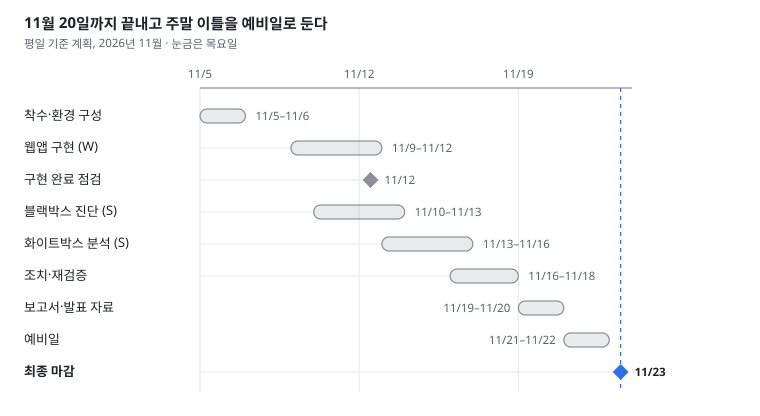
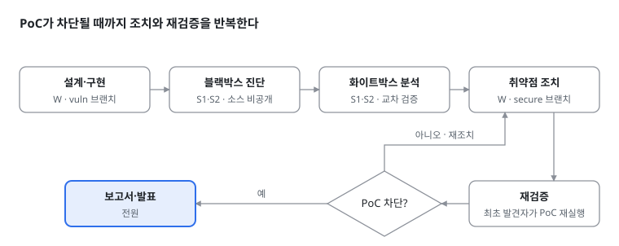

# 웹 해킹 프로젝트 팀 공유본

작성일 2026-11-05 · 세부 태스크: [plan/tasks.md](plan/tasks.md), 요약: [plan/tasks-summary.md](plan/tasks-summary.md)

OWASP Top 10:2025 취약점을 넣은 웹앱을 직접 만들고, 공격·조치·재검증까지 수행한다. 결과물은 취약/조치 버전 웹앱, 항목별 진단 보고서(PoC 포함), 최종 발표 자료다.

## 일정

마감은 2026-11-23(월)이고, 평일만 써서 11/20(금)에 끝내는 것이 목표다. 남은 주말 이틀은 예비일이다.

| 기간 | 단계 | 담당 |
| --- | --- | --- |
| 11/5 ~ 11/6 | 착수·환경 구성 | 전원 |
| 11/9 ~ 11/12 | 웹앱 구현 | W |
| 11/10 ~ 11/13 | 블랙박스 진단 | S1·S2 |
| 11/12 | 구현 완료 점검 | 전원 |
| 11/13 ~ 11/16 | 화이트박스 분석·교차 검증 | S1·S2 |
| 11/16 ~ 11/18 | 조치·재검증 | 전원 |
| 11/19 ~ 11/20 | 보고서·발표 자료 | 전원 |
| 11/21 ~ 11/22 | 예비일 | - |
| **11/23** | **최종 마감** | 전원 |

- 진단은 구현 완료를 기다리지 않는다. W가 기능 단위로 배포하면 S1·S2가 바로 블랙박스 진단을 시작한다.
- 착수 기간(11/5 ~ 11/6)에 S1·S2는 Burp·ZAP을 설치하고 DVWA로 기법을 연습한다.
- 11/12 구현 점검에서 10개 항목 중 미완성 항목이 있으면 그 항목은 범위에서 빼거나 Juice Shop 등 공개 취약 앱으로 대체한다.

## 역할 분담

| 역할 | 주 도구 | 담당 업무 | OWASP 항목 |
| --- | --- | --- | --- |
| 웹 개발 (W) | - | 취약 웹앱 구현, 환경 구성, 조치 버전 구현 | 전 항목 (구현·조치) |
| 보안 A (S1) | Burp Suite | 요청 변조 기반 수동 진단, PoC, 재검증 | A01, A05, A06, A07, A08 |
| 보안 B (S2) | ZAP, 의존성 스캐너 | 자동 스캐닝·설정 점검, PoC, 재검증 | A02, A03, A04, A09, A10 |

## OWASP Top 10 담당표

| 항목 | 웹앱에 넣을 취약점 | 담당 |
| --- | --- | --- |
| A01 Broken Access Control | ID만으로 글·프로필 수정, 관리자 URL 권한 미검사, SSRF | S1 |
| A02 Security Misconfiguration | 디버그 모드, 디렉터리 리스팅, 기본 관리자 계정 | S2 |
| A03 Software Supply Chain Failures | CVE 있는 구버전 라이브러리 | S2 |
| A04 Cryptographic Failures | 비밀번호 MD5/평문 저장, HTTP 전송 | S2 |
| A05 Injection | SQL 문자열 결합, 게시글·댓글 XSS | S1 |
| A06 Insecure Design | 추측 가능한 비밀번호 재설정 토큰 | S1 |
| A07 Authentication Failures | 로그인 시도 제한 없음, 세션 고정 | S1 |
| A08 Software or Data Integrity Failures | 업로드 파일 미검증, 쿠키 권한 값 평문 | S1 |
| A09 Security Logging and Alerting Failures | 로그인 실패·관리자 작업 로그 없음 | S2 |
| A10 Mishandling of Exceptional Conditions | 상세 오류 노출, fail-open | S2 |

## 진행 절차

구현은 기능 단위로 배포하고, 완성된 기능부터 진단을 시작한다.

## 작업 규칙

- 공격은 로컬 Docker 환경(`127.0.0.1` 바인딩)에서만 한다. 외부 서비스 대상 스캐닝·공격은 금지.
- 더미 데이터만 쓴다. 취약 버전(`vuln`) 저장소는 비공개로 둔다.
- W는 취약점 삽입 위치를 미리 알리지 않는다(블랙박스 진단 후 소스 공개).
- 발견 사항은 이슈 1건으로 등록한다: 항목, 재현 절차, 영향도, 권고 조치.
- S1·S2는 상대 담당 항목 PoC를 최소 1회 재현해 교차 검증한다.
- W는 수정 커밋을 이슈에 연결하고, 최초 발견자가 재검증 후 종결한다.

## 정해야 할 것

- [ ] 발표일(제출 마감은 11/23)
- [ ] 팀원별 W·S1·S2 배정(S1 = Burp Suite 희망자)
- [ ] Burp Suite 에디션(Community 또는 Professional)
- [ ] OWASP Top 10 기준 판(2025 또는 2021)
- [x] 웹앱 기술 스택: Django + SQLite
- [ ] 보고서 양식과 발표 시간
- [ ] 저장소·이슈 관리 도구
