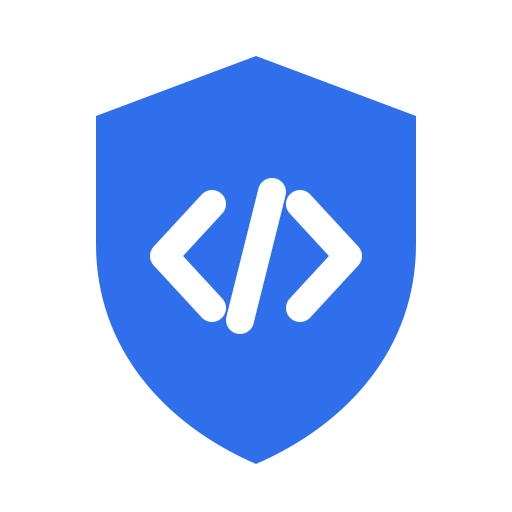
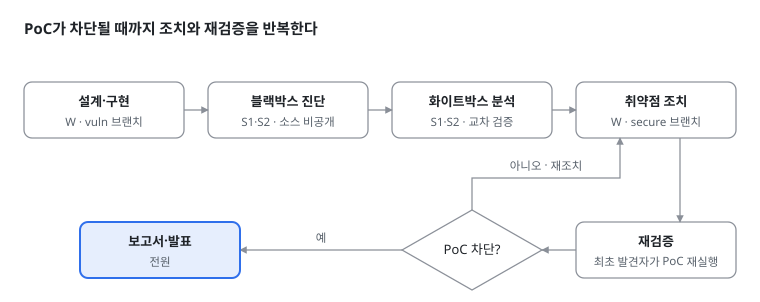

# 웹 해킹 프로젝트

OWASP Top 10 취약점을 의도적으로 넣은 웹 애플리케이션을 직접 만들고, 공격 → 분석 → 조치 → 재검증까지 한 사이클을 수행하는 3인 단기 프로젝트입니다.

- 기간: 2026-11-05 ~ 2026-11-23 (11/20 완료 목표)
- 기준: OWASP Top 10:2025
- 대상: 팀이 직접 만든 웹앱만. 외부 서비스·타인 시스템은 대상이 아닙니다.

## 팀 구성

| 역할 | 인원 | 주 도구 | 담당 |
| --- | --- | --- | --- |
| 웹 개발 (W) | 1 | - | 취약 웹앱 구현, 환경 구성, 조치 버전 구현 |
| 보안 A (S1) | 1 | Burp Suite | 수동 진단: A01, A05, A06, A07, A08 |
| 보안 B (S2) | 1 | ZAP, 의존성 스캐너 | 자동 스캔·설정 점검: A02, A03, A04, A09, A10 |

## 진행 절차



| 단계 | 기간 | 내용 |
| --- | --- | --- |
| 1 | 11/5 ~ 11/6 | 착수·환경 구성 |
| 2 | 11/9 ~ 11/13 | 웹앱 구현 + 블랙박스 진단 |
| 3 | 11/13 ~ 11/16 | 화이트박스 분석·교차 검증 |
| 4 | 11/16 ~ 11/18 | 조치·재검증 |
| 5 | 11/19 ~ 11/20 | 보고서·발표 자료 |

## 문서

| 문서 | 내용 |
| --- | --- |
| [PLAN.md](PLAN.md) | 팀 공유 기획서: 일정, 역할, OWASP 담당표, 작업 규칙 |
| [plan/tasks.md](plan/tasks.md) | 세부 태스크 (우선순위·단계·산출물·의존) |
| [plan/tasks-summary.md](plan/tasks-summary.md) | 태스크 요약 |
| [docs/](docs/) | 태스크별 완료 보고서 (`docs/<태스크 번호>.md`, 양식은 [_template.md](docs/_template.md)) |

## 디렉터리 구조

```
.
├── README.md
├── PLAN.md          # 팀 공유 기획서
├── plan/            # 세부 태스크
├── docs/            # 태스크 완료 보고서
└── assets/          # 다이어그램·아이콘
```

## 작업 규칙

- 공격은 로컬 Docker 환경(`127.0.0.1` 바인딩)에서만 합니다.
- 더미 데이터만 사용합니다.
- 발견 사항은 이슈 1건으로 등록하고, 최초 발견자가 재검증 후 종결합니다.
- 태스크를 끝내면 `docs/`에 완료 보고서를 남깁니다.

> 이 저장소의 취약 코드는 학습 목적입니다. 허가받지 않은 시스템에 사용하면 정보통신망법 등에 따라 처벌받을 수 있습니다.
